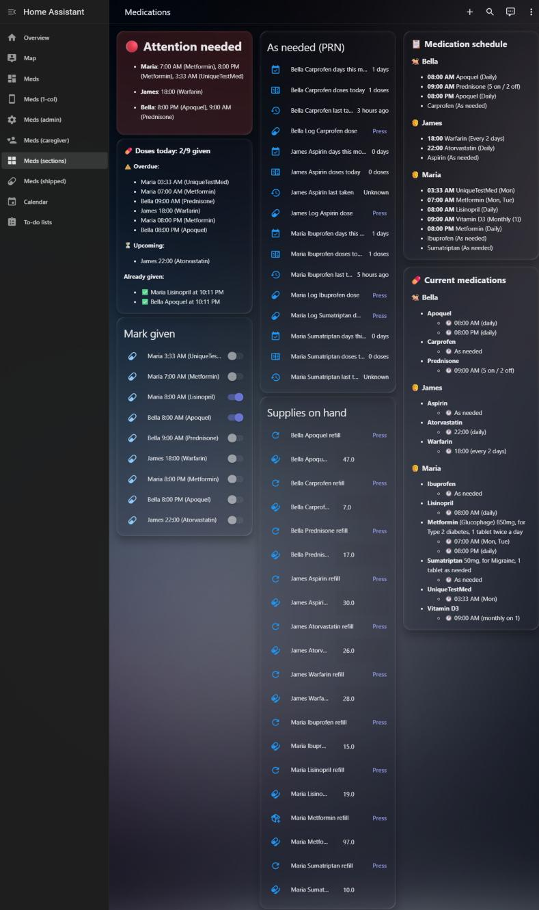
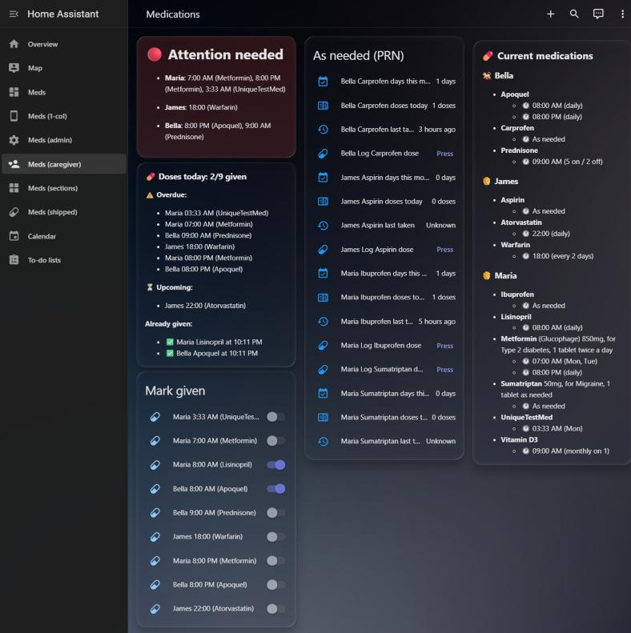
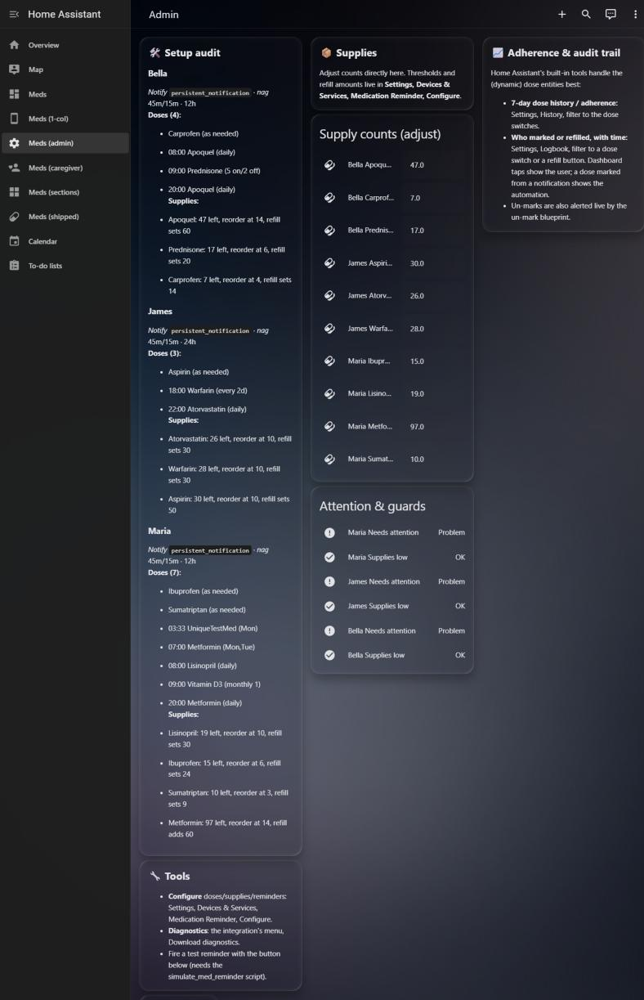
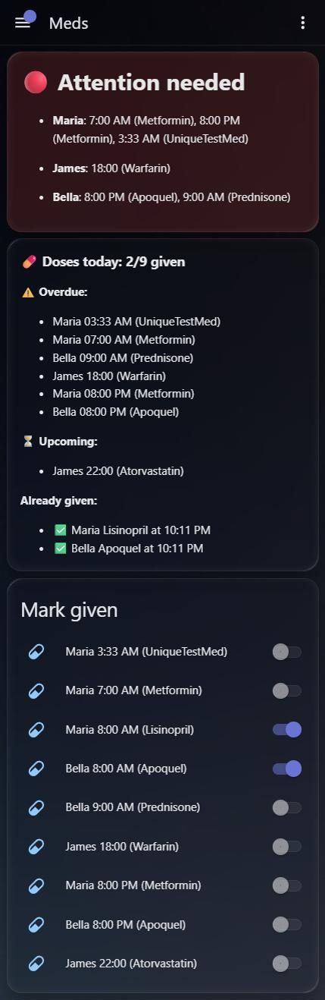
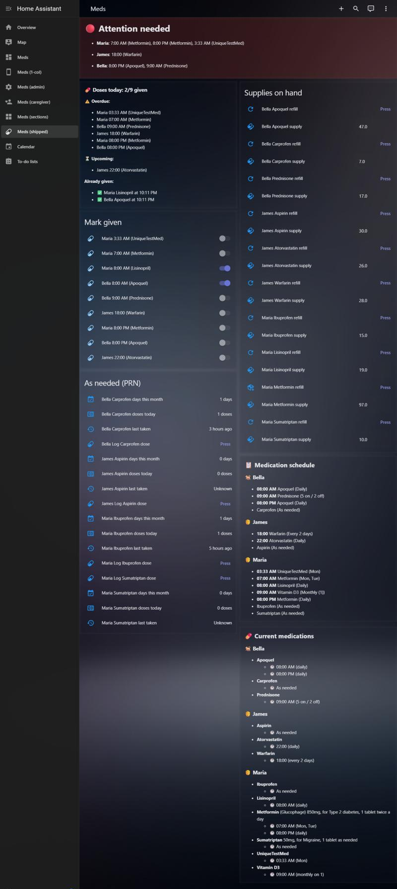

# Dashboards

Ready-made Lovelace dashboards for the Medication Reminder integration. They all
auto-discover your patients and doses, so there are no entity IDs to edit: add one
and it fills itself in. Every layout needs the two HACS frontend cards
[auto-entities](https://github.com/thomasloven/lovelace-auto-entities) and
[card-mod](https://github.com/thomasloven/lovelace-card-mod).

The screenshots below use three sample patients, two people (Maria, James) and a
dog (Bella), with a mix of scheduled and as-needed meds.

## Responsive dashboard (recommended)

[`lovelace-sections.yaml`](lovelace-sections.yaml) adapts to screen width: one
column on a phone, several on a tablet or desktop. Create a new dashboard, open
its three-dot menu, Edit dashboard, then Raw configuration editor, and paste the
whole file.

## Caregiver dashboard

[`lovelace-caregiver.yaml`](lovelace-caregiver.yaml) is a simpler, do-focused
view: status, today's doses to mark, as-needed logging, low supplies, and a
current-medications reference. It has no setup or config on it, so it is safe to
share with a non-admin Home Assistant user. Paste it into a new dashboard's Raw
configuration editor.

## Admin dashboard

[`lovelace-admin.yaml`](lovelace-admin.yaml) is the manage-and-audit companion to
the caregiver view: a full setup audit, editable supply counts, the attention and
guard sensors, pointers to History and Logbook, and a test-reminder button. Keep
this one for yourself and turn on "Admin only" under Settings, Dashboards.

## Single card, for an existing dashboard

[`lovelace-card.yaml`](lovelace-card.yaml) is the whole thing as one card you drop
into a dashboard you already have: Edit dashboard, Add Card, Manual, then paste. It
is a single column, so it suits a phone or a narrow column. Shown here on a phone:

## Single card, wide 2-column layout

[`lovelace-card-2col.yaml`](lovelace-card-2col.yaml) is that same card reorganised
for a wide area: a full-width status banner across the top, then two columns under
it. Add it the same way (Add Card, Manual), ideally somewhere with room to spread
out.

